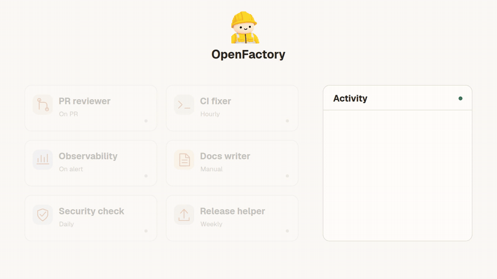

<p align="center">
  
</p>

<h1 align="center">OpenFactory</h1>

<p align="center"><strong>Your agents. Your computers. One factory.</strong></p>

<p align="center">
  Run Codex and Claude Code agents on your own machines.<br />
  Give them a task, set a schedule, and follow their work in one place.
</p>

<p align="center">
  <a href="#start">Get started</a> &middot;
  <a href="apps/site/content/docs/quickstart.mdx">Documentation</a> &middot;
  <a href="apps/desktop/README.md">Desktop app</a>
</p>

<p align="center">
  <a href=".github/assets/readme/openfactory-concept.mp4">
    
  </a>
</p>

<p align="center">
  A little help, on your own machines.<br />
  <a href=".github/assets/readme/openfactory-concept.mp4">Watch the video</a> &middot;
  <a href=".github/assets/readme/openfactory-concept.png">View the still illustration</a>
</p>

## Put your agents to work

- Review pull requests when a webhook arrives, or check CI on a schedule.
- Run a task yourself and continue the conversation when you need a follow-up.
- Organize agents into teams with shared instructions.
- Keep agent definitions in Markdown and YAML, with run history and usage in the app.

OpenFactory runs agents directly through Codex CLI or Claude Code CLI and reuses your existing sign-in. It manages schedules, webhooks, sessions, and queues on the runtime host. Provider credentials stay on that host.

## Start

Use Node 26 and pnpm 12.15.0. Install and sign in to whichever provider CLI you use on the runtime host. OpenFactory reuses that CLI's authentication and project configuration.

```sh
pnpm install
pnpm runtime:build
pnpm runtime:start
# In another terminal:
pnpm dev
```

Open http://localhost:8018. Create an agent, choose an absolute working directory, provider, model, and permissions, then use **Run now**. You can create your first agent without an existing schedule or provider session. New agents start paused; manual runs work while paused. Choose **Manual only** when you do not want a timer or webhook.

The web application has no multi-user authentication. Keep it on a trusted network, such as a private tailnet. Provider credentials stay on the host.

## Start sessions yourself

```sh
pnpm openfactory agents
pnpm openfactory run '<agent-id>'
pnpm openfactory read '<session-id>'
printf '%s' 'Continue with the next step.' | pnpm openfactory send '<session-id>' -
pnpm openfactory stop '<session-id>'
pnpm openfactory pause '<agent-id>'
pnpm openfactory resume '<agent-id>'
pnpm openfactory status
```

Each manual, timer, or webhook run creates a provider session. Follow-ups resume its saved native session ID and queue behind active work. The run page also shows the command for resuming in `codex resume` or `claude --resume` yourself. Stop active OpenFactory work before taking over that native session in another terminal.

Use `pnpm openfactory project /absolute/path [name]` to register a factory from the terminal. `pnpm openfactory create <json-file>` creates an agent using the fields in `packages/runtime/src/contracts.ts`'s `upsertSchema`.

## Agent definitions

The **Definition** tab edits `agent.md` directly:

```markdown
---
description: Review changes
agentType: CUSTOM
harness:
  type: codex
  model: gpt-6.1-sol
runtimeMode: auto-accept-edits
enabled: false
schedule:
  type: manual
---

Review the changes and report concrete findings.
```

Schedules can also use `type: interval` with `everyMs`, `type: fixed_time` with `timeOfDay` and optional `weekdays` (Sunday is `0`), or `type: webhook`. Fixed times use the runtime host's timezone. Saving applies the provider, model, permissions, instructions, enabled state, and schedule. It does not run the agent. Existing fields omitted from older definitions retain their current values.

**Factory definition** edits the YAML and Markdown in each repository’s `factory/` directory. These files are the source of truth for agents, teams, schedules, factory names, icons, and scorers. The selected runtime host reads and writes its repository files. Content revisions protect against stale saves, including edits made outside the app. Commit `factory/` with your code. Runtime history, credentials, and scheduler state stay outside the repository.

For existing installations, run `pnpm openfactory definitions-migrate` to preview the move, then `pnpm openfactory definitions-migrate --apply`. The migration preserves agent IDs and history, refuses conflicting destination files, and removes migrated global snapshots and settings. Normal operation reads only `factory/`; there is no legacy storage fallback. With the runtime stopped, add `--offline` to migrate an older installation before restarting it. Use `pnpm openfactory factory <project-id>` to inspect the resulting files and location.

## Teams

Create a team from the factory’s **Teams** page. Choose its lead and members from existing agents. Open **Factory definition** to edit the generated files:

```text
factory/factory.yaml
factory/agents/<agent-folder>/agent.md
factory/teams/<team-name>/team.yaml
factory/teams/<team-name>/instructions.md
```

A team references agent files relative to `factory/`:

```yaml
schemaVersion: v1alpha1
name: Reliability
description: Investigate incidents and report operational health.
instructions: ./instructions.md
lead: operator
members:
  operator:
    agent: agents/operator/agent.md
  digest:
    agent: agents/digest/agent.md
    reportsTo: operator
```

`instructions` is optional and resolves beside `team.yaml`. Member IDs are local to the team. Exactly one lead omits `reportsTo`; other members must report through a cycle-free chain to that lead. An agent can appear once in each team. Model, permissions, prompts, and schedules remain in `agent.md`.

Saving team files applies their membership and shared instructions without starting a run or changing agent schedules. Each new member turn receives its team guidance, including manual runs, timers, webhooks, and conversation follow-ups. Queued turns retain the guidance captured when queued. Reporting lines describe organization; they do not trigger delegation or grant permissions.

Use **Run lead** or a member’s **Run agent** button to start real work. The CLI can also apply a team folder or assign work to a member:

```sh
pnpm openfactory team-apply '<project-id>' /path/to/repo/factory/teams/reliability/team.yaml
pnpm openfactory teams '<project-id>'
pnpm openfactory team-run '<project-id>' teams/reliability/team.yaml digest 'Summarize the incident.'
```

`team-apply` copies a team folder into the repository’s `factory/teams/` directory and resolves agent references against its `factory/agents/` files. It preserves existing edits. Reapplying identical files keeps the same revision. Use `pnpm openfactory agents` to inspect actual agent IDs; the factory definition page shows their file paths.

## Webhooks

Set `OPENFACTORY_PUBLIC_URL` in the runtime environment to the web application's reachable origin. Copy the new endpoint from agent settings and enable the agent.

Requests use JSON and `POST`. The endpoint's random URL token authenticates unsigned requests. Optional HMAC-SHA256 signatures use the header/prefix/encoding from `schedule.signature`. Configure the secret from a private file:

```sh
pnpm openfactory webhook-secret '<agent-id>' /private/path/signing-secret
```

Webhooks support templates such as `{{body.event}}`, record delivery outcomes, and accept `Idempotency-Key` for retry deduplication. Keep request bodies under 1 MB. Paused agents reject deliveries.

## Move existing T3 agents

Keep T3 running only during the export and cutover:

```sh
pnpm runtime:migrate
pnpm runtime:migrate --apply
```

The script backs up existing agents and text transcripts, imports them paused, disables their old T3 schedules, and restores their enabled states and next due times in OpenFactory. It refuses to enable the new owner while an old conversation is active. Private snapshots and cutover receipts persist in `~/.config/openfactory/runtime/migration-t3`. Re-running the migration is safe.

Migrated webhook endpoints change; update senders to the new OpenFactory URL. Signing secrets must be configured again. Old T3 conversations remain read-only archives, while new work uses direct provider sessions. Binary attachments hosted by T3 remain there. See [runtime research, migration, and rollback](docs/research/direct-runtime.md).

## Persistence and execution

`packages/runtime` builds a standalone service with SQLite persistence and a private Unix socket. The default state directory is `~/.config/openfactory/runtime`; override it with `OPENFACTORY_RUNTIME_DIR`. Raw provider JSON events are retained alongside normalized transcripts and usage. `OPENFACTORY_CODEX_BIN` and `OPENFACTORY_CLAUDE_BIN` select non-default executable paths.

One agent executes one turn at a time. Different agents can execute concurrently. Worktree agents get a separate checkout for each session; follow-ups keep that checkout. Running turns interrupted by a restart are marked interrupted and are not automatically replayed. Queued turns survive restarts. Success means actual provider completion, not only a successful dispatch.

The dashboard, runs, assistant, scorer rules, and usage views read the owned runtime. Appearance and scorer settings remain in `~/.config/openfactory/workspace`. The team page at `/projects/<project>/teams` uses live agents and saved team definitions.

## Validate and deploy

### Host the landing page and docs on Vercel

Import this repository into Vercel with the repository root as the project root. The root `vercel.json` runs `pnpm build:site` and deploys the output from `.vercel/output`. Connect `the-agentic-company/openfactory` in the project's Git settings and use `main` as the production branch. Pushes to `main` deploy production automatically; other branches create preview deployments.

The public website lives in `apps/site` (`@openfactory/site`) and contains the landing page, downloads, documentation, and marketplace. The product UI and local server live in `apps/app` (`@openfactory/app`); `apps/desktop` packages that app with the runtime. Each frontend owns its routes, styles, dependencies, and build. Build guards reject imports across the app/site boundary or runtime code in the public site.

Run `pnpm dev` for the workspace on port 8018, or `pnpm dev:site` for the public website on port 8020. `pnpm build:app` builds the workspace; `pnpm build:site` builds the public deployment. Workspace documentation and marketplace links open `https://open-factory.app` in the browser. Set `VITE_OPENFACTORY_SITE_URL` at app build time to use another origin, such as `http://localhost:8020` for local development.

Run the workspace and agent runtime on your own computers using the instructions above. The public site's **Get started** link opens the local setup guide.

The public download links use the `desktop-v<version>` GitHub Release matching `apps/desktop/package.json`. Mac uses DMG installers, Linux offers `.deb` and `.AppImage`, and Windows uses `.exe`. The download page also links the Intel Mac DMG.

To build the public site locally:

```sh
pnpm build:site
pnpm verify:site
```

To build and verify the workspace without any public pages:

```sh
pnpm build:app
pnpm verify:app
```

After `pnpm --filter @openfactory/desktop build:workspace`, run `node scripts/verify-app.mjs apps/desktop/web` to check the exact web payload packaged by desktop.

GitHub Actions builds installers on Linux, macOS, and Windows for pull requests and pushes to `main`. Each build launches its packaged host and checks the runtime, persistence, and authenticated API before uploading artifacts. The macOS job also verifies both Apple Silicon and Intel archives.

To publish installers, update the desktop package version and push the matching `desktop-v<version>` tag. The workflow publishes all installers and self-contained CLI archives together after every platform passes, along with `SHA256SUMS`. The website serves `/install.sh`; its Terminal section shows a copyable command using the current website origin. The script installs the `openfactory` CLI on macOS or Linux without requiring Node or npm. Mac and Windows installers are unsigned previews.

For public downloads from a private source repository, create a public repository for release assets. Set the source repository's Actions variable `OPENFACTORY_RELEASES_REPOSITORY` to `owner/repository` and its secret `OPENFACTORY_RELEASES_TOKEN` to a token with Contents write access to that release repository. Set `VITE_OPENFACTORY_RELEASES_REPOSITORY` to the same `owner/repository` in Vercel. The public site defaults to `the-agentic-company/openfactory-releases`; `VITE_OPENFACTORY_RELEASES_REPOSITORY` overrides it. The release workflow uses the same public repository by default. Publishing there requires `OPENFACTORY_RELEASES_TOKEN`; the source repository's default token cannot publish to another repository.

### Run the workspace on your own host

```sh
pnpm check
pnpm test
pnpm build
./scripts/install-service.sh
systemctl --user status openfactory-runtime.service openfactory.service
```

The supplied units expect `~/git/openfactory`. The runtime starts at boot with the user's lingering systemd session, independently of a browser or T3. The dashboard listens on loopback port 8019. Put service settings such as `OPENFACTORY_PUBLIC_URL` in `~/.config/openfactory/service.env`.

When Tailscale is installed and connected, the installer configures private HTTPS at `https://<computer>.<tailnet>.ts.net:8018/` and saves this origin as `OPENFACTORY_PUBLIC_URL`. HTTP on the same port redirects to this HTTPS URL and preserves the path and query. HTTP links using the computer's short name or Tailscale IP also redirect to the full certificate hostname.

To update an existing installation, run `python3 scripts/configure-tailscale.py`. The script installs and enables `openfactory-tailscale-gateway.service`. Tailscale forwards port 8018 to this gateway on loopback port 8020. The gateway redirects HTTP and passes TLS unchanged to Tailscale Serve on port 8444, which manages certificates and proxies to the dashboard on loopback port 8019. Both the gateway and Tailscale configuration persist across restarts. The script refuses to replace unrelated services on these Tailscale ports.

Use the printed HTTPS URL from a device connected to your tailnet. The same URL supports hot reload when the dashboard service runs Vite in development mode. Check the gateway with `systemctl --user status openfactory-tailscale-gateway.service`. Local development still uses `http://localhost:8018`.

`install-service.sh` disables the old T3 token-renewal timer. It does not stop T3 itself or other users' T3 conversations. `scripts/stage-release.py` copies both the web build and bundled runtime into an immutable release under `~/.local/share/openfactory/releases`, then switches `current` atomically.

After later changes, build and run `./scripts/deploy-service.sh`. Deployment restarts both OpenFactory services, so finish or stop active turns first. Inspect logs with `journalctl --user -u openfactory-runtime.service -u openfactory.service -n 50`.

## Refresh the README animation

Install `agent-browser` with its Chromium browser and `ffmpeg`, then run:

```sh
pnpm exec node scripts/export-readme-animation.mjs
```

The script renders `scripts/readme-animation.html` locally and exports a looping GIF, an MP4, and a still illustration to `.github/assets/readme`. It uses demo content and does not need a running app or provider credentials. Open the HTML file in a browser to preview the animation. The browser preview respects reduced motion preferences.

## License

OpenFactory is licensed under the [Apache License 2.0](LICENSE).
Third-party code and assets retain their own licenses and attribution; see
[THIRD_PARTY_NOTICES.md](THIRD_PARTY_NOTICES.md).

GitHub secret scanning and push protection are enabled. The Secret scan workflow
runs Gitleaks against Git history on pull requests and pushes to `main`. To scan
locally with Gitleaks 8.30.1, run `gitleaks git --log-opts="--all" --redact`.
